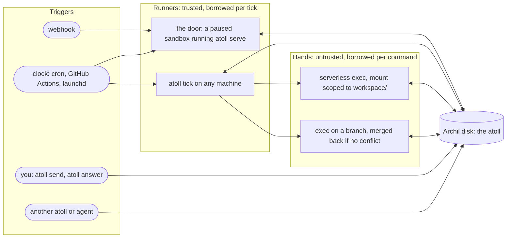

# A Place to Stand

The design of Atoll: standing agents that live on Archil disks

Jared McFarland · 4 November 2026 · Draft 1, written before the build and corrected after it (see
[Status](#16-status-of-this-document))

> "Give me a place to stand, and I will move the earth." Archimedes, on levers.
> An agent that runs for months needs the same thing: one place where everything it is can stand still
> while compute comes and goes.

## Contents

1. [Summary](#1-summary)
2. [The need, stated without actors](#2-the-need-stated-without-actors)
3. [What Archil's grain suggests](#3-what-archils-grain-suggests)
4. [The idea: an agent is a directory](#4-the-idea-an-agent-is-a-directory)
5. [What carries over from actord and Standing Systems, what changes, what is new](#5-what-carries-over-what-changes-what-is-new)
6. [The atoll format, version 1](#6-the-atoll-format-version-1)
7. [A turn, precisely](#7-a-turn-precisely)
8. [Where turns run: runners, the door, the clock, and hands](#8-where-turns-run)
9. [Changing a standing system](#9-changing-a-standing-system)
10. [The toolkit: CLI, library, and plugins](#10-the-toolkit)
11. [Reference systems](#11-reference-systems)
12. [Trust, secrets, and what runs where](#12-trust-secrets-and-what-runs-where)
13. [What it costs](#13-what-it-costs)
14. [What building this taught me about Archil](#14-what-building-this-taught-me-about-archil)
15. [Roadmap](#15-roadmap)
16. [Status of this document](#16-status-of-this-document)
17. [Sources](#17-sources)

---

## 1. Summary

I have been building toolkits for what I call standing systems: work a person hands off that stays on duty.
It watches something, follows up, waits for days without forgetting, and asks its owner when a decision
needs a person. My two prototypes put each piece of such a system in an actor: actord on Cloudflare
Durable Objects, and Standing Systems on Rivet. Actors were a good fit for the control side (an address, a
mailbox, one message at a time) and a poor fit for the context side (large, shared, forkable workspaces
that a model can read with ordinary tools).

Atoll starts from the other end. **The agent is a directory on an Archil disk.** Its charter, the events
waiting for it, everything it has done and why, what it is waiting for, the receipts behind its state, the
questions it has for its owner, its workspace, and the code that runs it are all files on one disk. Compute
is borrowed for each turn and thrown away: a laptop, a CI job, a paused Archil sandbox woken by a webhook,
or a serverless exec for untrusted work. Anything that holds the disk's ID and a credential can run the
next turn, so handing an agent to another machine means passing a disk ID.

On top of the disk, Atoll adds the four things a file system doesn't give you by itself:

- **Order.** Events are uniquely named files in `inbox/`, and one runner at a time holds the disk's lease.
  The lease is a sequence of objects created with S3's create-only write (`If-None-Match: *`), so the
  epoch number doubles as a fencing token that every journal record carries.
- **Atomic turns.** A turn may change many files, but it commits with exactly one append to the journal.
  The journal is the system's write-ahead log, and the files are its materialized view. A crash before
  the append means the turn never happened; a crash after it means recovery finishes installing it.
- **Honest effects.** Network calls, model calls, messages to people, and commands in microVMs are
  declared effects that run only after the turn that requested them has committed. Each one has an
  idempotency key, a budget, and optionally an approval. An effect whose outcome can't be known is
  reported as in doubt, never as done.
- **Time.** Archil has no timers, so waits are files and something outside calls `atoll tick`: a cron
  line, a GitHub Actions schedule, or a request to the door.

And it leans on what only a disk like Archil's makes cheap. Every question you can ask about an atoll,
you can also ask with `ls`, `cat`, and `grep`. A checkpoint is a consistent snapshot of the whole system
at once. A branch is a full copy of the system for trying a change against real history. Untrusted
commands get a mount of one subdirectory and nothing else. A command can even run as a transaction: on a
branch, merged back only if the journal shows nothing else touched the same files.

Atoll ships as a TypeScript runtime and CLI (`atoll`), plus plugins that teach Claude Code and Codex to
design, build, test, run, inspect, and change these systems. Two reference systems come with it: a
release watcher and a promise keeper.

## 2. The need, stated without actors

Both of my earlier projects reached for the same thing, and actors were the substrate, not the need. The
need, in plain words:

One person hands off ongoing work and leaves it running. A coding agent builds the system from a
description, and it runs for weeks or months on the person's own account, costing almost nothing between
events and keeping its memory across crashes, restarts, and changes to its code. It never speaks for the
person, spends past an allowance, or changes itself without them, and it asks only at explicit, typed
decision points that state their consequences, recommend an answer, and say what happens if nobody
replies. At any moment it can answer five questions:

1. What is it trying to accomplish?
2. What changed, and why?
3. What is it waiting for?
4. What evidence supports its state?
5. What does it need from me?

Standing Systems made those five answers the product, and kept six rules that are really six promises:

| Rule in Standing Systems | Promise to the person it serves |
| --- | --- |
| Every state change records its cause and evidence | Nothing changes without saying why, and showing the receipt |
| An idle, unfinished part declares what it waits for | Nothing sits idle without saying what it is waiting for |
| Models propose; code decides | AI suggests; your rules decide |
| Capabilities live in a trusted tier | Only trusted parts touch the outside world |
| Nothing goes to another person without approval | It never speaks for you without your OK |
| Budgets are declared and enforced | It never spends past the allowance you set |

actord added the builder's half: a typed declaration that the compiler checks, guarantees that each have a
test or are listed as not guaranteed, change classification before deploys, traces that say *unknown*
where the record ends, and plugins that make a coding agent good at this class of software without ever
letting it deploy on its own.

All of that survives the move to a disk. What doesn't survive is the actor-specific machinery: one
Durable Object per actor, SQLite transactions as the unit of atomicity, alarms as the clock, and actor
justification criteria as the way to argue a system into fewer units.

## 3. What Archil's grain suggests

I read every page of Archil's documentation, all 24 posts on its blog, and the shipped SDK source, and
probed the live service on a free account (sections 14 and 17). These are the properties Atoll is built
on, each confirmed by a probe or quoted from the docs.

**The disk is the identity; compute is disposable.** An Archil disk is durable once a write returns,
strongly consistent between every client that reaches the disk server (mounts, serverless exec,
sandboxes, and the S3 API), and addressable by ID from anywhere. Exec starts a fresh Firecracker microVM
with the disk mounted in about 100 ms from a laptop, and a paused sandbox wakes on an HTTP request in
about 0.7 s (my measurements, 5 November 2026, `aws-us-west-2`).

**The object API is free of compute.** Reads, writes, appends, listings, and deletes go through the
S3-compatible API and are not billed as tool calls. An atoll turn that changes only files costs nothing
but the bytes.

**Atomicity exists in two places, and both are enough.** A whole-object PUT is atomic. A create-only PUT
(`If-None-Match: *`) has exactly one winner: in two races of 10 concurrent writers each, one write
succeeded and nine got `412 PreconditionFailed`. Appends to an existing object are atomic and serialized:
in three trials of 20 concurrent appends, all 20 records landed whole, none duplicated, none interleaved.
There is no compare-and-swap: `If-Match` on a write returns `501 NotImplemented`.

**Checkpoints and branches are nearly free.** A checkpoint takes about 15 ms and a branch about 35 ms
regardless of disk size. A branch gets its own filesystem ID, which the object API and exec both accept as
a disk ID, so a branch is a full, independent copy of an atoll. Checkpoints are created from a mount, which
a single exec provides: `archil checkpoints create` ran inside exec in about 35 ms. Files can be read as
of a checkpoint over S3 with `versionId`, once the checkpoint becomes readable a few seconds after it is
taken.

**Untrusted code can be scoped by mount.** Exec mounts can be read-only, conditional (any client can write
anywhere nobody has checked out), or limited to a subdirectory. A command that should touch only a
workspace can be given only the workspace.

**There is no clock and no doorbell, except the network.** Archil has no triggers, webhooks, schedules,
timers, or change feeds anywhere in storage or compute. The only inbound wake path is network traffic: a
request to an exposed port, or with a port token, starts a stopped sandbox or resumes a paused one. The
docs say so directly: "Hand off through your orchestrator, not the file system."

**Some things are traps.** Concurrent appends through FUSE mounts lose data (three execs appending to one
file through conditional mounts, 20 lines each, kept 20 of 60), while the same appends through the object
API lose nothing. A plain sandbox mount takes the disk's whole write delegation and keeps it while paused, so every
other writer, including the S3 API, gets `409 OperationAborted`. Delegations never expire on their own.
Checkpoints and branches can't be deleted yet.

Archil's own writing sharpens what these primitives are for. "The unit of atomicity for agents is a task,
a goal, or a turn." "The harness itself is just data, it can be stored on the file system." Builders
expect "user-driven events (like Slack messages)" to "end up being a small percentage of triggers of the
agents in the fullness of time." "You give a diskId, and you get out a bash tool -- anywhere in the world."
And the roadmap item that matters most here: "The ability to indicate where the code to run an agent
harness is on your file system, and the ability to invoke it directly -- either through a rest API for
integrations, or via a webhook." Atoll builds that last one today, out of a paused sandbox and an outside
clock, and is designed so that both disappear when Archil ships it natively.

## 4. The idea: an agent is a directory

```text
$ atoll ls release-radar
CHARTER.md    what I asked it to do, and what it must never do
STATUS.md     the five answers, rewritten after every tick
atoll.json    the manifest: parts, effects, schedules, budgets, the code version that runs
inbox/        events waiting to be handled, one file each
journal/      every committed turn and every effect outcome, one line each, by day
parts/        each part's own files: what it knows, and what it is waiting for
asks/         questions for me, each with options, consequences, a default, and an expiry
outbox/       effects waiting for my approval, or whose outcome is in doubt
notices/      what it told me, by day
evidence/     receipts: every page it fetched, every model answer, every command's output
workspace/    where untrusted commands run
.atoll/       the lease, the code, staging, the meter, checkpoints
```

That listing is the whole agent. The five questions are files:

| Question | Where the answer lives | How to read it without Atoll |
| --- | --- | --- |
| What is it trying to accomplish? | `CHARTER.md`, and each part's purpose in `atoll.json` | `cat CHARTER.md` |
| What changed, and why? | `journal/`: each turn names its cause, its writes, and its evidence | `tail -n 5 journal/2026-11-04.jsonl` |
| What is it waiting for? | `parts/**/waiting.json` and `.atoll/next-wake` | `cat parts/watch/rivetkit/waiting.json` |
| What evidence supports its state? | `evidence/`, cited by hash from the journal | `grep -rl rivetkit evidence/` |
| What does it need from me? | `asks/` and `outbox/` | `ls asks/` |

Answering a question is writing a file: `asks/q42.1.answer.json`. The next tick picks it up, from
wherever it was written: the CLI, an editor on a Linux mount, Finder through Archil's macOS app, or any
S3 client.

Three properties fall out of this, and each matches something Archil does better than an actor runtime.

**A consistent snapshot of a whole system is one checkpoint.** In an actor system each actor's state is
private, so a consistent cut across actors needs a distributed snapshot protocol. Here the whole system is
one disk and one runner writes it at a time, so a checkpoint taken between ticks is a consistent cut of
every part, every inbox, and every open question.

**A copy of the whole system is one branch.** Trying a change against real history means branching the
disk, running the new code on the branch, and comparing the two directories. Nothing about the live
system is touched.

**Parts share an environment, not just messages.** In an actor system a part that wants another part's
data sends a message and waits for a reply. Here a part can simply read another part's files. Writes stay
owned: a part writes only under its own directory, and the runtime refuses anything else at commit. That
is the single-writer principle applied to paths instead of objects, which is how Archil's own docs tell
agents to share a disk.

## 5. What carries over, what changes, what is new

| Concept | In actord / Standing Systems | In Atoll | Gained or lost |
| --- | --- | --- | --- |
| Unit | An actor: identity, private state, mailbox | A part: a directory with an owner-voiced purpose; an instance is a subdirectory | Gained: state anyone can read with `cat`. Lost: encapsulation by construction; ownership is enforced by the runtime at commit |
| Identity | A Durable Object name or Rivet key | A path on a disk: `watch/rivetkit` | Gained: the address is also where the state is |
| Mailbox | SQLite inbox, one message at a time | `inbox/<event-id>.json`, one runner at a time via the lease | Gained: any process with the disk can deliver. Lost: per-actor parallelism (one runner per atoll) |
| Atomicity | One storage transaction per handler | One journal append per turn; files are installed after | Gained: a multi-file turn is atomic without a database. Lost: readers can see a turn half-installed (the journal is authoritative) |
| Ordering | Per-actor FIFO | Event IDs are time-ordered and monotonic per sender; one runner handles them in ID order | Same guarantee in practice; global FIFO across senders is not promised in either |
| Duplicates | Inbox dedupe by message ID, 7 days | `.atoll/seen/<event-id>` markers, created exclusively, 30 days | Same idea, readable as files |
| Clock | Durable Object alarms | Waits are files; an outside clock calls `atoll tick` | Lost: built-in alarms. Gained: the clock is any cron you already have |
| Effects | Declared, keyed, budgeted, approvable; `in_doubt` | The same, with outcomes in the journal and pending ones in `outbox/` | Same promises |
| Approvals | Parked effects, approved by email reply | An ask whose answer releases the exact approved payload once | Same promise |
| Decisions | Decision actors with options, consequences, expiry, default | `asks/<id>.json` and a rendered `.md` | Gained: answerable by editing a file |
| Evidence | Captured where it enters, cited by ID | Content-addressed files under `evidence/`, cited by hash | Gained: dedupe and integrity for free |
| Provenance | Cause chains in a timeline actor | Every journal record names its event, the event names its cause | Same; `atoll why` walks it |
| Unattributed changes | `onStateChange` outside `apply()` | `atoll check` compares the files under `parts/` with what the journal says they should be | Gained: works even for changes made by hand through a mount |
| Code | Deployed Worker or RivetKit registry | A bundle stored on the disk, versioned by hash | Gained: the disk carries its own harness; any runner can run it |
| Change safety | `actord diff` classifies schema changes statically | `atoll try` replays recorded events through new code and diffs the results | Gained: empirical, not static. Lost: it only covers the events that happened |
| Untrusted work | Containers with credentials kept outside | Exec microVMs with a mount scoped to `workspace/`; sandboxes when a process must stay up | Gained: scoping by mount, and branch-and-merge for commands |
| Where it runs | Your Cloudflare account; your home box | Any machine with the disk ID; a paused sandbox that wakes on a request | Gained: hand-off by disk ID |
| Builder tooling | CLI, skills, critics, hooks, the Room | CLI, skills, critics, a check-on-edit hook | The Room becomes `STATUS.md` and `atoll status`; the disk is the console |

What I deliberately did not bring over: actor kinds as a taxonomy (a part is code; it may call a model
through an effect, and that is all "model-assisted" ever meant), routes as a declared graph (sends are
validated against declared parts and handlers at commit instead), and per-actor isolation as the default.
On Archil, sharing is the default and isolation is something you claim. Atoll claims it in exactly two
places: the lease for the control state, and scoped mounts for untrusted commands.

## 6. The atoll format, version 1

An atoll is a directory tree with the layout in section 4, rooted at the top of a disk (or at a prefix, so
several atolls can share one disk). `.atoll/format` contains `atoll/1`. Everything below is what the
runtime reads and writes; anything else on the disk is left alone.

### 6.1 Identifiers

- **Event IDs** are 26-character ULIDs (Crockford base32: 48 bits of milliseconds, 80 bits of randomness),
  so lexical order is time order. Events from outside get a fresh monotonic ULID. Events created by a
  turn get a *derived* ULID: the turn's timestamp plus 80 bits of a SHA-256 of the turn's sequence number
  and the send's index. Re-installing a turn after a crash therefore recreates exactly the same IDs.
- **Turn sequence numbers** (`seq`) start at 1 and increase by one for every journal record.
- **Effect, ask, and notice IDs** are derived from the sequence number that created them:
  `fx42.0`, `q42.1`, `n42.0`.
- **Part addresses** are `<part>` or `<part>/<instance>`; instance names match
  `[a-z0-9][a-z0-9._-]{0,63}`.
- **Evidence references** are `sha256:<hex>`.
- **Code versions** are the first 16 hex digits of the bundle's SHA-256.

### 6.2 Events and the inbox

An event is a JSON file `inbox/<id>.json`:

```json
{
  "id": "01JC4Z7V3J8YQ2WQ8N5K6M3T1B",
  "type": "watch.poll",
  "to": "watch/rivetkit",
  "from": "@clock",
  "cause": "01JC4YXH0D0Z4E9F1A2B3C4D5E",
  "at": "2026-11-04T21:00:00.000Z",
  "body": {}
}
```

`from` is a part address, `@owner` (the CLI), `@clock` (timers and schedules), `@door`, or an effect ID.
Delivery is a create-only PUT, so delivering the same event ID twice while it is pending stores it once.
After a turn handles an event, the runtime creates `.atoll/seen/<id>` exclusively and deletes the inbox
file; a later redelivery of the same ID finds the marker and is recorded as a duplicate without running
any code. Markers older than 30 days are pruned, so dedupe has a 30-day window, which is stated in
`atoll status` and in the guarantees table.

### 6.3 The journal

`journal/<YYYY-MM-DD>.jsonl` (UTC day of commit) holds one JSON record per line. Every record has `v`,
`kind`, `seq`, `epoch`, `at`, and a `crc` (CRC-32 of the record serialized without `crc`), so a torn or
corrupt final line is detectable and ignored. Each day's file is created with an empty PUT before its first
append, because concurrent first appends to a missing object conflict.

A **turn record** (`kind: "turn"`) holds everything needed to reproduce the turn's effects on the disk:

```json
{
  "v": 1, "kind": "turn", "seq": 42, "epoch": 7, "at": "2026-11-04T21:00:03.120Z", "code": "c3f2a1b07d9e4410",
  "event": { "id": "...", "type": "watch.fetched", "to": "watch/rivetkit", "from": "fx41.0", "cause": "...", "at": "...", "body": {} },
  "part": "watch/rivetkit",
  "writes": [ { "path": "parts/watch/rivetkit/latest.json", "sha256": "...", "size": 118, "text": "{...}" } ],
  "deletes": [],
  "sends": [ { "id": "...", "to": "ledger", "type": "release.seen", "body": {} } ],
  "effects": [ { "id": "fx42.0", "name": "npm.fetch", "args": {}, "then": "watch.fetched", "key": "..." } ],
  "waits": [ { "until": "2026-11-04T22:00:03.120Z", "reason": "next poll" } ],
  "asks": [], "notices": [], "evidence": [ "sha256:..." ],
  "note": "rivetkit 3.0.1 is new", "crc": "9f2c41aa"
}
```

Writes up to 32 KiB carry their content inline (`text` for UTF-8, `b64` otherwise), so the journal is a
true write-ahead log. Larger writes are staged first at `.atoll/staging/<seq>/<n>` and referenced by hash.
A record must fit in one append (1 MiB); the runtime stages more content when a record would not.

Other record kinds share the same sequence: `effect` (an effect's outcome: `started`, `done`, `failed`,
`in-doubt`, `awaiting-approval`, `denied`, `over-budget`), `failure` (a handler threw; the event stays in
the inbox for another attempt and is moved to `inbox/dead/` after three), `duplicate`, `push` (new code
became current), `checkpoint`, and `merge` (section 8.5).

### 6.4 Parts and instances

A part is declared in code with an owner-voiced purpose ("Tell me about each new version of this package
on npm"), its handlers keyed by event type, and optionally schedules. A part with `instances: true` has one
directory per instance under `parts/<part>/<instance>/`, created by the first event addressed to it; a
singleton part lives at `parts/<part>/`. A part may read anything in the atoll and write only under its own
directory, which the runtime checks at commit. Each directory may hold any files the part likes; Atoll
reserves only `waiting.json`.

### 6.5 Waits, timers, and schedules

A turn ends by declaring what its part is waiting for (`until` a time, `for` an event type, or an ask), or
by declaring the part done. Waits a turn declares replace the part's waits; a turn that declares none
keeps the waits its event didn't satisfy. That way a turn that moves a deadline drops the old timer, and a
turn that handles something unrelated doesn't forget what the part was waiting for. The runtime writes the declaration to `waiting.json` and keeps an index of
timed waits in `.atoll/timers.json`; `.atoll/next-wake` holds the earliest due time. A tick first delivers
a `timer` event for each due wait (with an ID derived from the address and due time, so a timer fires
once), then handles the inbox.

Schedules (`every: "1h"` or a five-field `cron`, evaluated in a declared time zone, UTC by default) are
timers the runtime re-arms after each firing. Singleton parts' schedules are armed when code is pushed;
instance parts' schedules are armed when the instance handles its first event. An `every` schedule keeps
its cadence from the time it was due, not from the moment a tick handled it, so a clock that ticks as often
as the interval never skips one. A missed schedule fires once on the next tick, not once per missed period.

`atoll check` flags any part that is neither done nor waiting for something: the rule "nothing sits idle
without saying what it is waiting for."

### 6.6 Asks

A turn may ask its owner a question:

```json
{
  "id": "q42.1", "from": "promise/deck-for-sam", "question": "Send Sam a reminder about the deck?",
  "why": "You promised the deck by Friday; it is Monday and there is no reply in the thread.",
  "options": [
    { "id": "send", "label": "Send the draft", "consequence": "Sam gets the reminder below, from you." },
    { "id": "wait", "label": "Wait two more days", "consequence": "I ask again on Wednesday." },
    { "id": "drop", "label": "Drop it", "consequence": "I stop tracking this promise." }
  ],
  "recommend": "wait", "expires": "2026-11-07T17:00:00Z", "default": "wait",
  "payload": { "draft": "Hi Sam, ..." }, "evidence": [ "sha256:..." ]
}
```

It lands as `asks/q42.1.json` and `asks/q42.1.md`. An answer is `asks/q42.1.answer.json` with `option` and
optionally an edited `payload`, written by `atoll answer` or by hand. The next tick turns the answer into an
`ask.answered` event for the asking part and moves both files under `asks/closed/`. An expired ask is
resolved with its default as `ask.expired`. Every ask must have a default and an expiry, so the owner is
never a hard bottleneck.

### 6.7 Effects, the outbox, and approvals

Effects are declared once, by name, with a kind and a policy:

| Kind | What it does | Idempotent by default |
| --- | --- | --- |
| `http` | One HTTP request; the body is saved as evidence, and `pick` keeps only the named JSON fields in the result | GET and HEAD only |
| `exec` | One command in an Archil microVM, against a scoped mount of the atoll's disk | No |
| `model` | One call to Anthropic or OpenAI, chosen by the model's prefix, with an optional JSON schema. Without the key, the effect's stand-in answers; without a stand-in, the call fails and costs nothing | No |
| `notify` | Tells the owner: a notice file, and optionally a push to a webhook | Yes (keyed) |
| `custom` | Code in the atoll's own bundle, run by the trusted runner | As declared |

A result is journaled twice, once with the effect's outcome and once with the turn that handles it, so
results stay small. An HTTP body over 16 KiB isn't inlined; the result carries `tooLarge: true` and a
`body` reference, and the handler reads the bytes with `t.readEvidence(ref)`. Any result over 64 KiB is
replaced by the same kind of pointer. Without that rule a single large response could exceed the journal's
one-append limit and fail the commit.

A handler requests an effect by name and names the event type its result should come back as. Effects run
after the requesting turn commits: the runner appends `started`, performs the effect, captures the result
as evidence, appends `done` or `failed`, and delivers the result event. If the runner dies between
`started` and the outcome, recovery finds the gap. An idempotent effect is retried with the same key; any
other effect is marked `in-doubt`, and the runner asks the owner what happened (it happened, retry it, or
drop it).

An effect declared with `approval: true` doesn't run until its owner says so. The runner writes
`outbox/<fx>.json` with the exact arguments and opens an ask. Approving spends the approval exactly once on
the approved (or edited) arguments, and the journal records which answer authorized it. Denying, or letting
the ask expire, delivers a result with `denied: true`. Approval defaults to *deny* on expiry.

### 6.8 Budgets and the meter

Budgets are declared per effect name or kind, per day or month: dollars for models, calls for exec and
http. The meter lives in `.atoll/meter/<YYYY-MM>.json` and is advanced by effect outcome records, so it can
always be recomputed from the journal. An effect that would exceed its budget doesn't run; the runner marks
it `over-budget` and asks whether to raise the allowance. A model call whose price is unknown counts
against the budget at the declared ceiling, never as zero.

### 6.9 Evidence

`evidence/<hh>/<sha256>` holds the bytes and `evidence/<hh>/<sha256>.json` the metadata (source, type,
time, size). Content addressing makes captures idempotent and deduplicated, so evidence is written before
the turn's commit append without harm if the turn then aborts. The journal cites evidence by hash, and
`atoll why` follows the citations.

### 6.10 Notices and STATUS.md

A turn can tell its owner something: `notices/<YYYY-MM-DD>/n42.0.md`. After every tick the runner rewrites
`STATUS.md` with the five answers in plain prose, so the agent can be read from Finder, a phone with an S3
client, or `cat`.

### 6.11 Code on the disk

`atoll push` bundles the project's `system.ts` with esbuild into one ESM file and stores it at
`.atoll/code/<version>/system.mjs`, then points `.atoll/code/current` at it and appends a `push` record.
Runners load the current bundle from the disk, so an atoll carries its own harness, and every turn record
names the code version that produced it. The runtime itself is also copied to `.atoll/bin/atoll.mjs` so a
sandbox with the disk mounted can run it with nothing installed.

## 7. A turn, precisely

### 7.1 The lease

One runner at a time may handle events for an atoll. The lease is a directory of epoch objects:
`.atoll/lease/<epoch>`, with the epoch zero-padded to 20 digits so lexical order is numeric order.

- **Acquire.** List `.atoll/lease/` and read the highest epoch `E`. If it is held and not expired (its
  `expiresAt` plus a 10-second skew margin is in the future), the atoll is busy. Otherwise create
  `.atoll/lease/<E+1>` with a create-only PUT. Exactly one contender wins; the rest see `412` and back off.
- **Renew.** The holder rewrites its own epoch object with a later `expiresAt` (default TTL 60 s, renewed
  every 15 s). Only the holder ever writes that object.
- **Fence.** Immediately before every commit append, the holder checks that `E+1` does not exist. Every
  journal record carries its epoch. A reader that meets a record whose epoch is lower than one already seen
  treats it as written by a stale runner, and `atoll check` reports it.
- **Release.** The holder rewrites its epoch object with `released: true`, so the next runner doesn't wait
  for expiry.

On a local directory the create-only PUT is `open(O_CREAT | O_EXCL)`; on a conditional Archil mount the
same call executes on the disk server. The residual risk is the standard one for leases without a
storage-side fencing check: a runner that stalls for longer than the TTL between its fence check and its
append could commit one stale record. That record is detectable, and the next holder's recovery
re-installs the authoritative history over anything it installed.

### 7.2 The commit protocol

For one event:

1. **Read.** The handler runs against the current files. Reads go to the disk; writes, sends, effects,
   waits, asks, notices, and evidence are buffered in memory.
2. **Validate.** Writes must stay under the part's own directory, sends must name a declared part with a
   handler for the event type, effects must be declared, and the record must fit in one append. A failure
   here is a handler failure: nothing is written.
3. **Stage.** Evidence is written (content-addressed). Writes over 32 KiB are staged under
   `.atoll/staging/<seq>/`.
4. **Fence and commit.** Check the lease, then append the turn record. **This append is the commit
   point.** Archil commits an append before it returns, so a returned append is durable.
5. **Install.** In order, idempotently: put each write; delete each delete; create each send's inbox file
   (create-only); create each ask and outbox entry (create-only, so a re-install never resurrects a closed
   ask); write each notice; write `waiting.json` and update the timer index; create the `.atoll/seen/`
   marker; delete the handled inbox file; delete the staging directory; update `.atoll/head.json`.
6. **Effects.** Run the turn's effects (section 6.7). Their result events join the inbox and are handled
   in the same tick.

### 7.3 Recovery

Every runner recovers when it acquires the lease, before it handles anything:

1. Find the last committed record from `.atoll/head.json` and the tail of the latest journal files,
   ignoring a torn final line.
2. Re-install every turn record after the last one `head.json` says was installed. Install is idempotent
   and applied in order, so the result is the same however far the previous runner got.
3. Delete staging directories for sequence numbers that never committed.
4. Resolve effects that were `started` without an outcome: retry the idempotent ones, mark the rest
   `in-doubt` and ask. An effect whose question was answered just before a crash gets that answer applied.

### 7.4 What Atoll guarantees, and the test behind each

| Guarantee | Mechanism | Test |
| --- | --- | --- |
| A turn's file changes, sends, effects, waits, and asks happen together or not at all | One append as the commit point; idempotent install | `test/runtime/crash.test.ts`: a crash injected at every mutating storage operation of a two-turn tick (each before and after the write lands), then recovery by a fresh runner, leaves each event handled exactly once and `atoll check` clean |
| An event ID is handled at most once within 30 days | Create-only inbox delivery and `.atoll/seen/` markers | `test/runtime/semantics.test.ts`, "duplicates" |
| Every event delivered is eventually handled or dead-lettered with a notice | Inbox files persist until a committed turn deletes them; three failures dead-letter | `test/runtime/basics.test.ts` |
| One runner at a time | Create-only epoch objects; fencing before commit | `test/runtime/semantics.test.ts`, "the lease": 20 concurrent acquirers, 5 concurrent ticks, and a takeover just before a commit; live in `test/live/` |
| An effect is never reported done without a recorded outcome | `started` / outcome records; `in-doubt` otherwise | `test/runtime/crash.test.ts`, "effects across a crash" |
| An approved effect runs once, with exactly the approved arguments | The ask's answer is recorded as spent | `test/runtime/semantics.test.ts`, "approvals" |
| A budget is never exceeded by an effect that hasn't run yet | Meter check before each effect | `test/runtime/semantics.test.ts`, "budgets" |
| A timer fires once per due time, and a missed schedule once | Derived event IDs plus create-only delivery | `test/runtime/semantics.test.ts`, "waits, timers, and schedules" |
| Replaying the journal through the same code reproduces every turn | Handlers see only recorded inputs and a recorded clock | `test/runtime/semantics.test.ts`, "replay" |
| A forked command merges back only if nothing else changed the files it touched | Content-hash precondition per file | `test/runtime/hands.test.ts` |
| `atoll check` finds files under `parts/` that the journal didn't write | Compare file hashes with the journal's last write per path | `test/runtime/basics.test.ts`, `test/cli.test.ts` |

### 7.5 What Atoll does not guarantee

- **Exactly-once external effects.** A non-idempotent effect whose runner died mid-call is reported in
  doubt; only the remote side's own idempotency can prevent a duplicate.
- **Global ordering across senders.** Events are handled in ID order, which is close to arrival order.
- **A consistent view of files mid-tick.** A reader that lists `parts/` during a tick can see a turn half
  installed. The journal, `STATUS.md`, and checkpoints taken between ticks are consistent.
- **Exact timing.** Timers fire at the first tick after they are due, so their precision is the clock's.
- **Mutual exclusion under clock skew beyond the margin.** The lease assumes runners' clocks agree within
  10 seconds; stale commits beyond that are detected, not prevented.
- **Isolation of untrusted code from the atoll's owner.** A branch is not a security boundary, and a
  disk's credentials reach every branch and checkpoint. Scoped mounts limit what a command can touch; they
  don't hide the disk from someone holding its API key.
- **Deploys.** Atoll never pushes code, creates a disk, starts a door, or installs a clock on its own; the
  plugins answer a request to do so with the plan and the command for a person to run.

## 8. Where turns run



### 8.1 Runners

A runner is any process that holds the disk's ID and a credential and calls `atoll tick`: it acquires
the lease, recovers, delivers due timers, handles the inbox until it is empty or the tick's limit is
reached, runs effects, rewrites `STATUS.md`, optionally checkpoints, and releases the lease. A runner holds
nothing between ticks. My laptop, a CI job, and a sandbox are interchangeable runners of the same atoll.

### 8.2 The door: a sandbox that sleeps

A webhook needs an address. `atoll door up` creates a small Archil sandbox (1 vCPU, 1 GiB) that mounts the
atoll's disk in **conditional** mode, so the object API keeps working for every other client, and runs
`node .atoll/bin/atoll.mjs serve` from the disk as a supervised service. Its HTTP API accepts `POST
/events`, `POST /tick`, and `GET /status`. Access is through an Archil port token, which Archil checks
before a request reaches the sandbox and which also wakes it. With a short idle TTL the sandbox pauses
between events and costs nothing while paused; my probe measured about 0.7 s from an HTTP request to a
200 from a paused sandbox.

The door holds no state of its own, so it can be deleted and recreated at any time. It needs no Archil
API key: it reaches the disk through its mount. On a mount, Atoll invalidates the client's cache at the
start of every tick, because a mounted client can serve a directory listing up to five minutes stale.

The door runs the code on the disk, and it has none of this machine's environment, so it needs the model
keys that code calls its models with. `atoll door up` reads them from the code and uses exactly those. It
refuses to start a door that would fail every call, one with a model effect that has no stand-in and no
key here, and it says which effects will answer with their stand-ins instead.

What the door may reach, and where a key lives, depend on the Archil plan. On a plan that can set a
sandbox's network policy (Developer and above), the door is created with one that denies everything
except three things: the hosts its effects declare in `allow`, the model APIs its keys go to, and Archil's
own endpoints for the disk, which a sandbox's mount needs like any other traffic. Each key goes into that
policy as a rule for its provider's host. Archil sets the key's header on the door's requests to that
host, and the service holds only a placeholder in the key's variable, so nothing that runs in the sandbox
can read the key. Archil rewrites those requests under a CA it installs in the sandbox, and the script
that creates the service passes that CA's location on to it.

The Free plan refuses a network policy. There the door comes up on Archil's managed allowlist, and a key
travels in one exec's env field to a small script in the sandbox, which creates the service with it. On
either plan the value is never part of a command's text, never in what comes back, and never on the disk.
My first version set the sandbox's own `env` instead. Archil applies that to the commands you exec, but
the live test showed it doesn't reach the services a sandbox supervises: the door's turns ran without the
key.

### 8.3 The clock

Archil has no timers, and pretending otherwise would be the one dishonest thing in this design. Every
tick writes `.atoll/next-wake`, `atoll status` says when the next wait is due and whether any clock is
configured, and `atoll clock` writes the configuration for one: a crontab line or launchd job that runs
`atoll tick`, a GitHub Actions workflow that does the same with the API key as a secret, or a `curl` to the
door with its port token. If Archil adds scheduled exec or harness invocation, the clock becomes a line in
`atoll.json`.

### 8.4 Hands

An `exec` effect runs one command in a fresh microVM with the atoll's disk mounted in conditional mode and
scoped to a subdirectory (`workspace/` by default), so an untrusted command can't read or rewrite the
journal, the asks, the lease, or the code. The runner wraps the command to list the files it changed, and
records them in the effect's outcome, so changes made by hands are attributed in the journal like any
other. Output over Archil's 4 MiB cap is reported as truncated.

### 8.5 Commands as transactions

An `exec` effect with `fork: true` runs on a branch instead:

1. Checkpoint the disk (one exec) and branch from the checkpoint.
2. Run the command on the branch, scoped as above. The wrapper hashes every file under the scope before
   the command runs and again after, so it reports each changed file together with the content the
   branch started from.
3. For every file the command touched, compare the main atoll's current content with that starting
   content. A difference means something else changed the file while the command ran: another runner's
   effect, a person editing through a mount, anything at all, journaled or not.
4. If nothing differs, commit a `merge` record that copies the command's changes into the main atoll,
   through the same commit protocol as a turn. If anything differs, nothing from the branch lands, and
   the requesting part gets the result with `merged: false` and the conflicting paths, to retry or ask
   the owner.

This is optimistic concurrency for bash, built from shipped primitives: the branch provides isolation,
a content-hash precondition provides the conflict check, and the commit protocol provides atomicity. Each forked command
costs two tool calls and leaves one branch and one checkpoint behind, which atoll counts in `atoll status`
because Archil can't delete them yet.

## 9. Changing a standing system

A first deploy is the easy part. A standing system is valuable for as long as it can be changed safely
while it runs.

**Replay.** `atoll replay` reads the journal and re-handles every recorded event on a fresh local
directory, each through the code version that recorded it (every pushed version stays on the disk), and
each against the exact files its turn saw, with its recorded result and time. Handlers see only recorded
inputs, so the replay must reproduce every turn; on the live release radar it reproduced 17 of 17 turns
across two code versions. With `--code` it replays everything through one version instead.

**Try.** `atoll try` replays recorded history through the working copy's code and reports, per part, the
files that would differ, the sends and effects that would differ, and any effect the new code requests that
history has no result for. It is a diff of behavior against real traffic, not a classification of
schemas. It covers only what actually happened, and says so.

**Push.** `atoll push` stores the new bundle and makes it current. Events already in the inbox are handled
by the new code, which is why `atoll try` comes first.

**Checkpoints and forks.** A checkpoint is taken at every push and, if configured, after every tick on the
door. `atoll fork` branches the disk at a checkpoint and prints the new branch's ID, which every `atoll`
command accepts like any disk, so a full copy of the system can be inspected, ticked, and changed without
touching the original. Rolling back means pushing the previous code version, or adopting the branch.

## 10. The toolkit

### 10.1 The CLI

| Command | What it does | Archil cost |
| --- | --- | --- |
| `atoll doctor` | Checks Node, credentials (from the environment or the project's `.env`, which it checks git ignores), region, and the SDK; never prints a secret | none |
| `atoll init <dir>` | Scaffolds a project: `system.ts`, `CHARTER.md`, tests, project guidance for Claude Code and Codex | none |
| `atoll create <name>` | Creates the disk (or opens one by ID) and lays out an empty atoll. Where files already are, it shows the top level and stops unless `--alongside`; `--prefix` gives the atoll a folder of its own | one disk |
| `atoll push` | Bundles `system.ts`, stores it on the disk, makes it current, checkpoints | one exec for the checkpoint |
| `atoll send <to> <type> [json]` | Delivers an event | none |
| `atoll tick` | Runs turns until the inbox is empty | none, unless effects use exec |
| `atoll status [part]` | The five answers | none |
| `atoll why <path\|event\|seq>` | The turn that produced it, and its cause chain with evidence | none |
| `atoll log` | Turns and effect outcomes | none |
| `atoll asks` / `atoll answer <id> <option>` | Questions for you, and answering them | none |
| `atoll check` | The declaration, the six promises, idle parts, unattributed files, stale-runner records | none |
| `atoll replay` / `atoll try` | Section 9 | none |
| `atoll fork` / `atoll checkpoint` | Branch or checkpoint the disk | one exec for a checkpoint |
| `atoll door up\|down\|url\|token` | The sleeping sandbox; `up` sets what it may reach and arranges the model keys its code uses | sandbox time while awake |
| `atoll clock` | Writes clock configuration, naming the model keys a runner elsewhere needs | none |
| `atoll serve` | The door's HTTP server, for any machine | none |

Every command takes `--dir <path>` for a local atoll or `--disk <name-or-id>` for an Archil disk. Without
either, a command uses the disk named in the project's `package.json` (`"atoll": {"disk": "radar"}`) and
otherwise the project's local atoll in `.atoll-local/`, so nothing reaches the cloud by accident. Every
command supports `--json`. Exit codes: 0 ok, 1 a check failed, 2 usage, 3 not in an atoll project.

Two more commands exist because the Free plan can't mount a disk on your own machine: `atoll ls [prefix]`
and `atoll cat <path>` read a disk's files through the object API, which is the `ls` and `cat` of section
4 for anyone without a mount.

### 10.2 The library

```ts
import { defineSystem } from "@standing-systems/atoll";

export default defineSystem({
  name: "release-radar",
  parts: {
    watch: {
      purpose: "Tell me about each new version of this package on npm",
      instances: true,
      schedules: [{ every: "1h", send: "watch.poll" }],
      on: {
        "watch.poll": (t) => {
          // Keep only the version in the result; the evidence keeps npm's whole answer.
          t.effect("npm.get", { url: `https://registry.npmjs.org/${t.instance}/latest`, pick: ["version"] }, { then: "watch.fetched" });
          t.wait({ for: "watch.fetched", reason: "the registry's answer" });
        },
        "watch.fetched": async (t, e) => {
          // A result arrives as { ok, result, error? }; for http, result is { status, json, body, bytes }.
          const latest = e.body.ok && e.body.result.status === 200 ? e.body.result.json?.version : undefined;
          const seen = await t.json<{ version: string }>("latest.json");
          if (latest && latest !== seen?.version) {
            t.write("latest.json", { version: latest });
            t.send("ledger", "release.seen", { name: t.instance, version: latest }, { evidence: e.evidence });
          }
          // No t.wait here: the schedule is re-armed by the runtime, so the part keeps waiting for it.
        },
      },
    },
    // ledger and digest omitted
  },
  effects: { "npm.get": { kind: "http", allow: ["registry.npmjs.org"], budget: { calls: 5000, per: "month" } } },
});
```

`@standing-systems/atoll/testing` gives tests an atoll on a temporary directory with effects replaced by stubs, a controllable
clock, and fault injection at any storage operation, so the same tests that check behavior also check
crash safety.

### 10.3 Plugins for Claude Code and Codex

Archil publishes no Claude Code or Codex plugin, skill, or MCP server, so this is open ground. The Claude
Code plugin carries:

- **Skills:** `start` (orient, run `atoll doctor`), `design` (draw the atoll as a table of parts, events,
  waits, asks, effects, and budgets, and write `CHARTER.md` in the owner's voice), `build` (handlers and
  tests against a local atoll, then `atoll check`), `inspect` (answer "what is it doing" and "why did that
  happen" from the disk), `evolve` (replay, try, then push), and `run` (create the disk, push, door, clock,
  always as a plan for a person to approve).
- **Critics:** `part-critic` argues for fewer parts and asks whether each directory earns its keep;
  `effect-auditor` reviews effects for idempotency keys, approvals, budgets, and honest in-doubt handling.
- **A hook** that runs `atoll check` after edits to `system.ts` and reports only hard errors.
- **`bin/atoll`**, so the CLI is on the agent's PATH while the plugin is enabled, preferring a project's
  pinned version.

The Codex plugin carries the same skills and launcher. Rules that must hold even when no skill fires (never
push or start a door without the person; keep existing tests; ask before spending) also go into the
`CLAUDE.md` and `AGENTS.md` that `atoll init` writes, because my actord evaluations showed that skills often
don't fire and project guidance always loads.

### 10.4 How a coding agent builds an atoll

The intended loop, which the skills encode:

1. The person describes what they want kept standing.
2. The agent proposes the atoll as a table: each part, what it owns on disk, what it waits for, what it
   asks, what it may do in the person's name, and its budget. The critics review it.
3. The agent writes `system.ts`, `CHARTER.md`, and tests on a local atoll, and runs `atoll check` and the
   tests until they pass.
4. The agent shows the plan to make it real: create the disk, push, door or clock. The person runs it.
5. Later changes go through `atoll try` against the live journal before `atoll push`.

## 11. Reference systems

**Release radar** (`examples/release-radar`): watches npm packages, keeps a ledger of releases it has seen,
classifies them by semver, tells me once per significant release, and writes a weekly digest. It is
deterministic: no model. It shows instances as directories, schedules, an idempotent `http` effect with
evidence, a ledger that dedupes by business key, notices, and a digest that reads another part's files
instead of messaging it. Its one outside host, the npm registry, is declared in `npm.get` and is also on
the Free plan's sandbox allowlist, so the whole system runs on a free account, including on the door.

**Promise keeper** (`examples/promise-keeper`): takes messages in, proposes the commitments they contain
through a `model` effect (a stand-in model by default), keeps one directory per promise, waits until each
is due, and when one is overdue, drafts a reminder and asks before sending it. It shows "models propose;
code decides," asks with defaults and expiry, an approval spent once on the exact text, and a budget.

## 12. Trust, secrets, and what runs where

| Component | Trusted | Holds | Reaches |
| --- | --- | --- | --- |
| Runner (`atoll tick`) on your machine or CI | Yes | Archil API key; model keys if configured | The disk, declared effect hosts |
| The door (sandbox) | Yes | On a plan with network policies, placeholders: Archil adds the model keys to its requests. On the Free plan, only the model keys its code uses. The disk arrives as a mount | The disk (mount) and the hosts its effects declare; on the Free plan, Archil's egress allowlist instead |
| Handlers (`system.ts`) | Your code | Nothing | Only the turn API; `atoll check` flags network or process imports in the bundle |
| Hands (exec) | No | Nothing: exec's environment carries only the disk ID and region | A mount of one subdirectory; today, also the open internet |
| Plugins | Yes | Nothing | Your project; the CLI; never the network on their own |

The API key never goes into a sandbox, a bundle, the disk, or the journal. Archil API keys reach every disk
in an account, so the design scopes untrusted code by mount rather than by credential.

A door's model key is a different case, because the door has to call the model. On a plan that can set
network policies, Archil's credential brokering sets the key on the door's requests to the provider, so the
guest never holds it at all (section 8.2). The key is then with Archil, as part of the sandbox's policy.
Archil's API gives that policy back with the key in it, so it is exactly as readable as the account's API
key makes it, and that key never goes into a sandbox. On the Free plan, the door holds the key in its
service's definition. A door's
policy also admits only the hosts its effects declare, so an effect of any kind that reaches the network
from a door lists its hosts in `allow`; for an http effect the runner checks each request against the
same list.

The CLI takes credentials from the environment or, as Archil's own setup prompts keep them, from the
project's `.env`. The environment wins, and `atoll doctor` fails while git would commit the file. Local
hands, which stand in for exec during development, run each command with only `PATH`, `HOME`, the locale
and the like, so no command can read the runner's keys and write them into evidence. They still run as
you, though. On your machine, isolation comes from Archil's exec, not from atoll.

## 13. What it costs

At Archil's list prices (November 2026):

- **An atoll at rest:** its files at $0.20 per GiB-month. Release radar's disk is under 1 MiB after a week,
  well under a cent a month.
- **A turn:** no tool calls. The control plane is the object API.
- **Hands:** $0.05 per 1,000 exec calls; a forked command is two calls.
- **The door:** $0.055 per vCPU-hour plus $0.020 per GiB-hour while running, nothing while paused. A door
  woken 100 times a day for about 20 seconds each is awake about 17 hours a month: about $1.25 at 1 vCPU and
  1 GiB.
- **The clock:** a crontab line costs nothing; a GitHub Actions schedule costs Actions minutes, not Archil.

The Free plan (1,000 tool calls and one sandbox-hour a month, five disks) runs both reference systems from
a laptop or CI indefinitely, since their turns cost no tool calls. It can run a door for a demo but not as a
standing host; that needs the Developer plan.

## 14. What building this taught me about Archil

These are product notes from building on Archil for a few days, offered the way I'd want them about my own
product. Each one is something I measured or worked around.

1. **The missing primitive is the trigger.** Everything Atoll needed existed except a way to run code
   stored on the disk when a webhook arrives or a time passes. The door and the outside clock are the
   workaround. Harness invocation from the disk, plus scheduled exec, would delete both.
2. **Create-only PUT is the coordination primitive, and the SDK hides it.** The S3 API honors
   `If-None-Match: *` and gave exactly one winner in every race I ran, but `putObject` doesn't expose it, so
   Atoll calls the SDK's internal S3 request method. A public `ifNoneMatch` option, and eventually
   `If-Match` on writes, would make leases, idempotent delivery, and compare-and-swap first-class.
3. **Checkpoints need an API.** Creating one needs a mount, so a laptop runner spends an exec on it. A
   checkpoint also isn't readable for several seconds after it returns (`503 SlowDown`, "The checkpoint is
   not readable yet").
4. **Appends behave differently by path.** Object-API appends were atomic in every trial; FUSE appends from
   concurrent clients lost data. The docs say concurrent FUSE writers are last-writer-wins, but the
   asymmetry is easy to trip on, and object-API append atomicity is documented only in one guide.
5. **The first append to a missing key can fail under concurrency** (`409 OperationAborted`, "The
   destination key was created by another writer while this append was in progress"), so logs need to be
   created before they're shared.
6. **Exclusive mounts are a sharp default for agent infrastructure.** A plain sandbox mount blocked every
   object-API write, even while the sandbox was paused. The docs already say conditional mode will become the
   default; for agents, I'd make it so.
7. **Retention needs a story.** Branches and checkpoints can't be deleted yet, so any system that forks per
   task accumulates them forever. Atoll counts what it creates.
8. **Exec has no env, cwd, or timeout options** (an open SDK pull request adds image and size options),
   and today it reaches the open internet, which the docs advise not to rely on.
9. **Small doc drift:** the sandbox default image (`ubuntu:26.04` in the CLI, `node:24-bookworm` on the
   server), the idle TTL default, and the services command name differ between pages.
10. **Usage isn't visible to an API key.** The billing routes answered `404 billing_unavailable` in
    `us-west-2`, a disk's `monthlyUsage` stayed at "$0.00" after dozens of execs, and only grep reports
    compute used. On a plan with hard caps, a standing system has to keep its own ledger of tool calls and
    sandbox minutes, so Atoll's meter does.
11. **A whole-object PUT erases appends in flight.** In one probe a PUT that landed while appends were
    running erased ten appends that had each been acknowledged with `200`. That is defensible for an
    object store, but a journal must never be rewritten in place; Atoll only ever creates journal files
    and appends to them.
12. **A paused sandbox wakes only on a new connection.** A request sent over a keep-alive connection that
    was open before the pause hangs for fifteen seconds or more, and the sandbox stays paused. Node's
    `fetch` reuses connections, so this broke two of three measurement runs until the door client opened a
    fresh connection for every request. It is easy to hit from any HTTP client with a pool.
13. **Small surprises in the S3 view:** keys are normalized like paths (`a/../b` is written as `b`),
    `.archil/` is reserved, Content-Type isn't stored, the append limit is 2047 KiB rather than the
    documented 1 MiB, and the SDK's `startAfter` listing option is ignored by the server.

## 15. Roadmap

Version 0.1 has everything in sections 6 to 11. Next, in order of value:

1. **Native triggers.** Replace the door and the clock with Archil harness invocation and scheduled exec as
   soon as they exist.
2. **Context composition.** Declare read-only context disks (an organization's skills, reference data) that
   hands mount beside the atoll's own disk, matching the skills, reference, memory, and shared-memory split
   Archil has written about.
3. **Agent parts.** A built-in part whose handler is a model loop: each step a committed turn, the
   conversation a file, tool calls as effects. An agent loop is a chain of turns, so it inherits crash
   safety, budgets, and inspection.
4. **Shell parts.** A part whose handlers are executables in its directory, run in exec with the event as a
   file, for systems written entirely in bash.
5. **Calibration.** actord's shadow mode and scorecards for model proposals, stored as files.
6. **A Finder view.** `STATUS.md` already renders; checkpoints browsable as folders through the macOS app
   would make history tangible.

## 16. Status of this document

I wrote this document before the build and corrected it afterwards. Everything in sections 6 to 11 is
built. Where the build taught me something, the text now says what the code does:

- The merge check for forked commands is a content-hash precondition (section 8.5). My first design
  checked the journal and couldn't see writers outside it.
- Waits a turn declares replace the part's old waits (section 6.5).
- HTTP results are capped and can `pick` fields (section 6.7). Without the cap, one large answer could
  overflow a journal append; without `pick`, polled answers dominated the journal.
- The CLI defaults to a local atoll (section 10.1) and has `ls` and `cat` for disks you can't mount.
- Installing a record runs its independent writes concurrently, in ordered phases. That roughly halved a
  turn's latency from a laptop, and the crash tests cover it.
- Local hands give commands a clean environment (section 12). The first build passed on the runner's
  whole environment, so a command could have written an API key into evidence. Archil's own agent
  adapters strip those keys, and comparing Atoll with them is how I caught it.
- `atoll create` and `atoll push` look before laying an atoll out where files already are, and the CLI
  reads the project's `.env`, both as Archil's own setup prompts do.
- A model effect with no key and no stand-in used to come back as a success with empty text, charged to
  its budget. It now fails, names the key, and costs nothing, and `atoll check` refuses a model name Atoll
  couldn't call (section 6.7).
- `atoll door up` used to give the door no model keys, so its turns answered with stand-ins and nothing
  said so. It now hands over the keys the code uses, and refuses when one would be missing (section 8.2).
  The live test of that fix also showed that a sandbox's own `env` doesn't reach its services, which is
  why the key goes in through the service's definition.

- A door used to hold its model keys and reach whatever its plan's sandboxes could. On a plan that can set
  network policies it now reaches only what its effects declare, and Archil holds its keys (sections 8.2
  and 12). I built that from Archil's description of network policies, and the live tests then showed it
  holds: the mount works under a policy that admits nothing else, an undeclared host is refused, and
  Archil sets the key on a request that left the sandbox without one. With a real key, a model answered a
  turn taken in the door. `docs/verification.md` has the runs.

The guarantees in section 7.4 each name the test that checks them. `docs/verification.md` records what
ran, what it showed, and what wasn't verified, with the Archil resources used.

## 17. Sources

**Archil documentation** (docs.archil.com, read in full on 4 November 2026): concepts/sharing-disks,
concepts/branches-and-checkpoints, details/consistency, details/architecture, protocols/s3-api,
compute/serverless-execution, compute/sandboxes/introduction, compute/sandboxes/firewall,
administration/billing, reference/limits, reference/archil-cli, sdks/typescript, guides/agents/*,
guides/platforms/*, guides/training/rl-environments, reference/changelog.

**Archil's blog** (archil.com/post/*, all 24 posts), especially:
"The file system is the agent" (8 June 2026), "Building file system transactions for agents" (1 May 2026),
"Agents share environments, not data" (18 April 2026), "Bash is the SQL for file systems" (15 April 2026),
"Who will build Vercel for agents?" (5 June 2026), "Agents were built for the $5 VPS" (16 June 2026),
"Be careful which persistent disks you trust" (19 June 2026), "Building the last WAL on S3" (21 August
2026), "Introducing Persistent Sandboxes" (28 August 2026).

**Code:** the `disk` package 1.11.0 (TypeScript SDK and CLIs), `archil` 0.20.0 (Python), and
github.com/archil-data (archil-sdk, agent-swarm).

**My own probes** of the live service on a free account, 5 November 2026 UTC, `aws-us-west-2`, from a
laptop; scripts and raw results in `docs/research/probes/`.

**My earlier projects:** actord (github.com/actor-systems/actord) and Standing Systems.

Research notes behind this document are in `docs/research/`.
